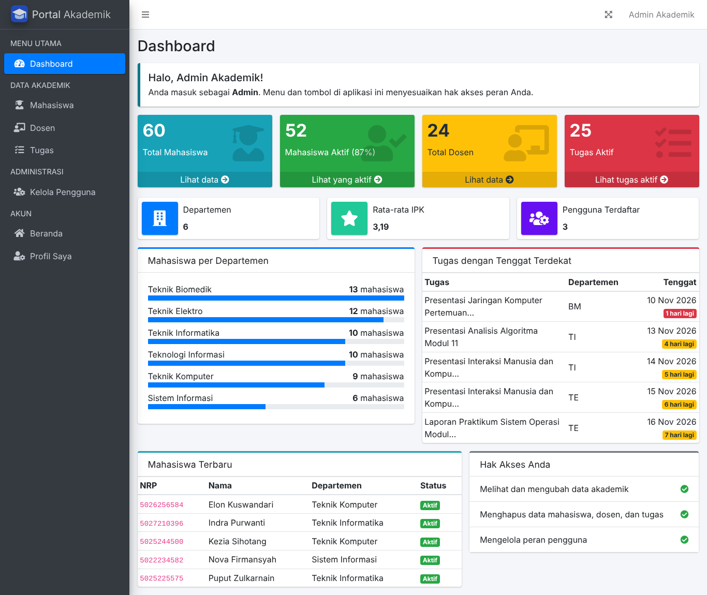
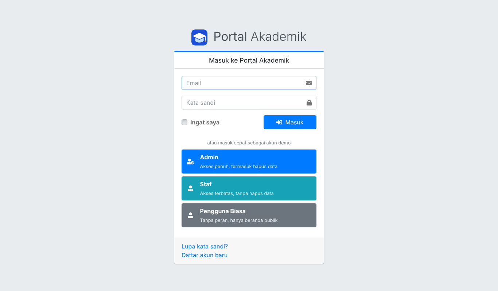
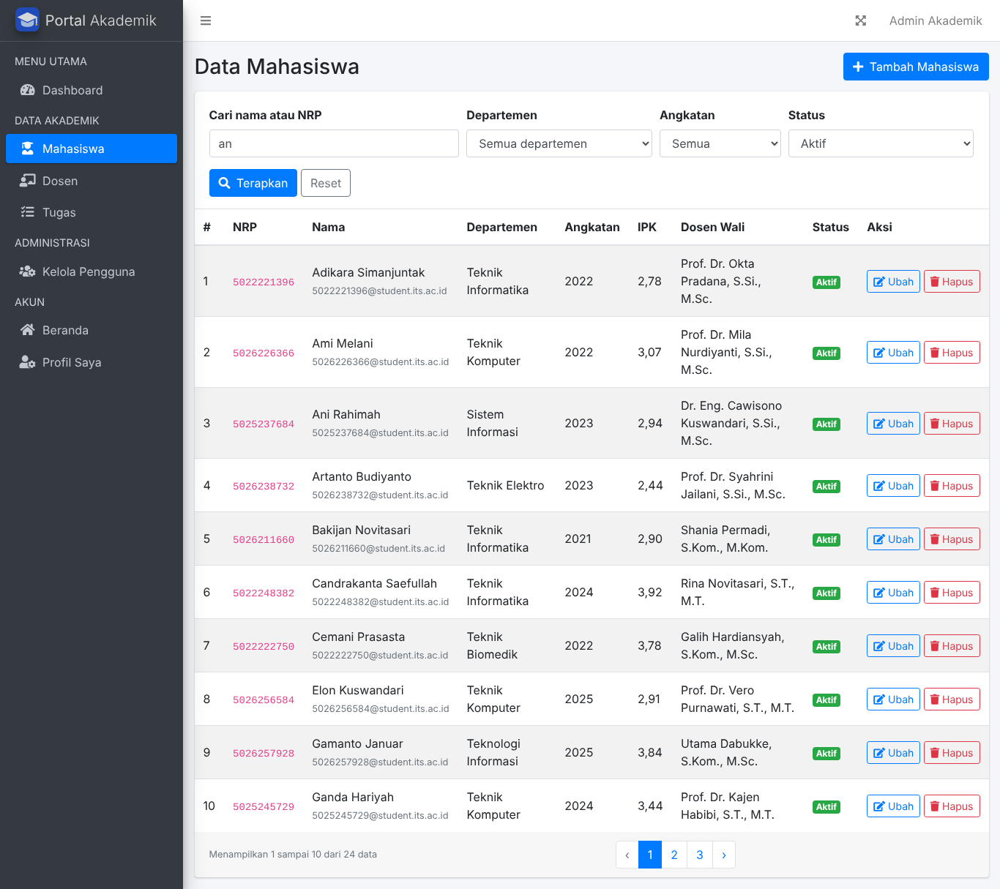
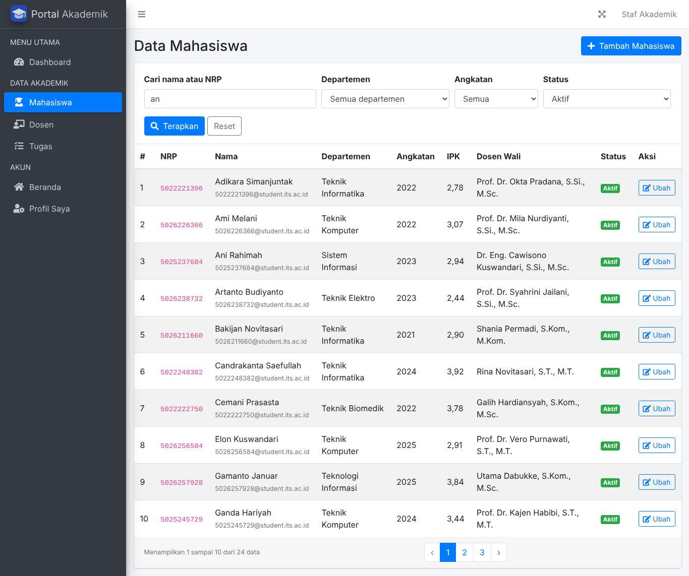
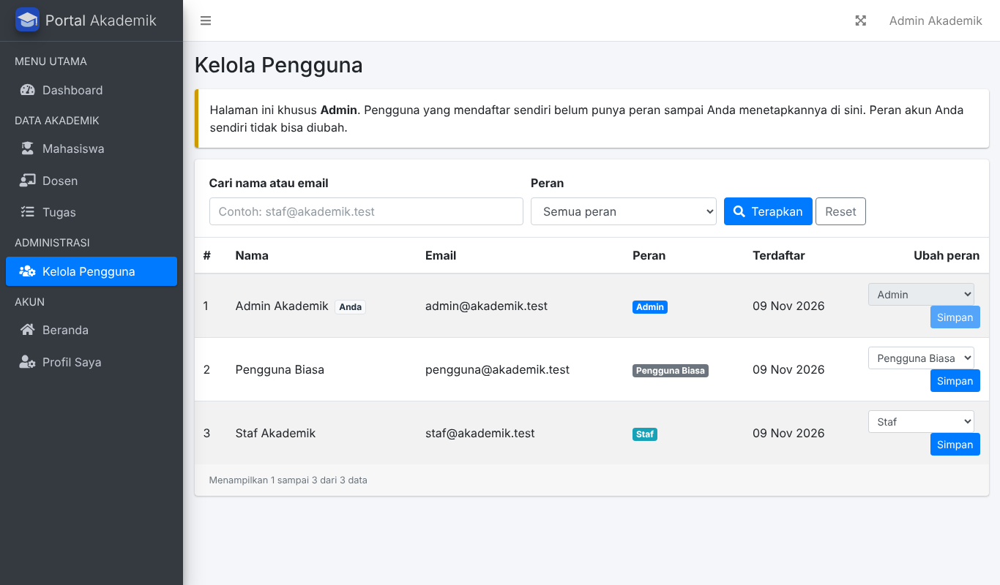
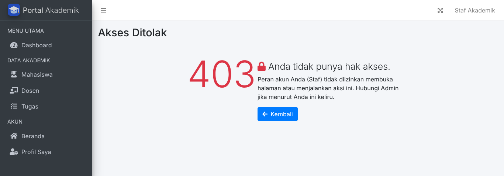

# Portal Akademik: Admin Dashboard dan RBAC

Tugas Mandiri PBKK Pertemuan 10 (*Admin Dashboard & Role-Based Access Control*).
Aplikasi Laravel 12 dengan panel admin AdminLTE, autentikasi Laravel Breeze, dan hak akses berbasis peran memakai Spatie Laravel Permission.

| | |
|---|---|
| Nama | Muhammad Nabil Fauzan |
| NRP | 5025241024 |
| Program studi | Teknik Informatika, Institut Teknologi Sepuluh Nopember (ITS) |



## Fitur

- **Dashboard admin** dengan 7 widget statistik dinamis yang dihitung langsung dari database lewat `count()` dan `avg()`: total mahasiswa, mahasiswa aktif beserta persentasenya, total dosen, tugas aktif, jumlah departemen, rata-rata IPK, dan jumlah pengguna. Di bawahnya ada jumlah mahasiswa per departemen, tugas dengan tenggat terdekat, mahasiswa terbaru, dan ringkasan hak akses pengguna yang sedang login.
- **CRUD Mahasiswa, Dosen, dan Tugas** dengan validasi Form Request berbahasa Indonesia.
- **Pencarian dan filter** memakai `when()`, dengan paginasi yang mempertahankan filter lewat `withQueryString()`.
- **RBAC** dengan Spatie Permission yang tersimpan di database: Admin (akses penuh), Staf (terbatas), dan Pengguna Biasa (tanpa peran).
- **Kelola Pengguna**: Admin dapat mengatur peran pengguna lain. Peran akun sendiri tidak bisa diubah.
- **Login cepat** dengan tombol akun demo di halaman login.
- **Data dummy** dari Faker: 6 departemen, 24 dosen, 60 mahasiswa, dan 36 tugas.
- **Kualitas kode**: 87 test otomatis dan gaya kode PSR-12 yang diperiksa dengan Laravel Pint.

## Hak akses

| Kemampuan | Admin | Staf | Pengguna Biasa |
|---|:---:|:---:|:---:|
| Membuka dashboard admin | Ya | Ya | Tidak (403) |
| Melihat daftar mahasiswa, dosen, dan tugas | Ya | Ya | Tidak (403) |
| Menambah dan mengubah data | Ya | Ya | Tidak (403) |
| Menghapus data | Ya | Tidak (403) | Tidak (403) |
| Mengelola peran pengguna | Ya | Tidak (403) | Tidak (403) |
| Beranda dan Profil Saya | Ya | Ya | Ya |

Ada 14 permission: `lihat-dashboard`, `kelola-pengguna`, serta `lihat-`, `tambah-`, `ubah-`, dan `hapus-` untuk masing-masing `mahasiswa`, `dosen`, dan `tugas`. Admin memegang semuanya, Staf memegang 10 (semua kecuali `hapus-*` dan `kelola-pengguna`).

Pembatasan dipasang berlapis, jadi menyembunyikan tombol saja tidak cukup untuk menembusnya:

1. **Route**: grup `admin` hanya bisa dimasuki peran `admin` atau `staf` (`role:admin|staf`).
2. **Controller**: middleware permission di constructor, misalnya `$this->middleware('permission:hapus-mahasiswa')->only('destroy');`.
3. **Blade**: tombol dan menu dirender dengan `@can(...)`, sehingga yang tidak berhak tidak melihatnya.

Permintaan `DELETE` yang dikirim manual oleh Staf tetap ditolak server dengan status 403.

## Screenshot

| Login dengan akun demo | Data Mahasiswa sebagai Admin (ada tombol Hapus) |
|---|---|
|  |  |

| Data Mahasiswa sebagai Staf (tanpa tombol Hapus) | Kelola Pengguna (khusus Admin) |
|---|---|
|  |  |

Staf yang membuka halaman khusus Admin akan mendapat halaman 403:



## Instalasi

Prasyarat: PHP 8.2 atau lebih baru (ekstensi umum Laravel ditambah `pdo_sqlite`), Composer 2, dan Git. Node.js tidak diperlukan karena aset AdminLTE sudah disertakan di `public/vendor`.

```bash
git clone https://github.com/nabeelz06/portal-akademik-dashboard-rbac_Nabeelz.git
cd portal-akademik-dashboard-rbac_Nabeelz
composer setup
php artisan serve
```

Buka http://127.0.0.1:8000 di peramban. `composer setup` menjalankan `composer install`, menyalin `.env.example` menjadi `.env`, membuat `APP_KEY`, membuat berkas SQLite, lalu menjalankan `php artisan migrate --seed`.

Langkah manual yang setara:

```bash
composer install
cp .env.example .env
php artisan key:generate
touch database/database.sqlite
php artisan migrate --seed
php artisan serve
```

Di Windows PowerShell, pakai `Copy-Item .env.example .env` dan `New-Item database/database.sqlite -ItemType File` sebagai pengganti `cp` dan `touch`.

Untuk MySQL, ubah `DB_CONNECTION` dan `DB_*` di `.env`, buat databasenya, lalu jalankan `php artisan migrate --seed`. Untuk mengembalikan data ke kondisi awal, jalankan `php artisan migrate:fresh --seed`.

## Akun uji

Kata sandi semua akun: `password`

| Peran | Email |
|---|---|
| Admin | `admin@akademik.test` |
| Staf | `staf@akademik.test` |
| Pengguna Biasa (tanpa peran) | `pengguna@akademik.test` |

Halaman login juga menyediakan tombol **Admin**, **Staf**, dan **Pengguna Biasa** untuk masuk tanpa mengetik. Tombol ini hanya muncul bila `DEMO_LOGIN=true` dan `APP_ENV` bukan `production`. Untuk deployment sungguhan, isi `DEMO_LOGIN=false` di `.env`.

## Pengujian dan gaya kode

```bash
composer test     # seluruh test (SQLite in-memory)
composer lint     # cek PSR-12 dengan Pint, tanpa mengubah berkas
composer format   # rapikan otomatis dengan Pint
```

## Skenario demo

1. Di halaman login, klik **Admin**. Dashboard menampilkan widget statistik dan menu lengkap.
2. Buka **Mahasiswa**, ketik `an` pada pencarian, pilih status Aktif, lalu klik Terapkan. Pindah ke halaman 2 dan lihat filter tetap terbawa.
3. Hapus satu data dengan tombol merah. Tombol ini hanya ada untuk Admin.
4. Keluar, lalu klik **Staf**. Daftar yang sama muncul tanpa tombol Hapus dan menu Kelola Pengguna tidak ada. Membuka `/admin/pengguna` langsung menghasilkan 403.
5. Keluar, lalu klik **Pengguna Biasa**. Akun ini diarahkan ke Beranda, dan `/admin/dashboard` menghasilkan 403.
6. Masuk lagi sebagai Admin, buka **Kelola Pengguna**, lalu ubah peran salah satu pengguna.

## Pemetaan ketentuan tugas

| Ketentuan | Implementasi | Lokasi |
|---|---|---|
| Melanjutkan proyek portal akademik | Model Departemen, Dosen, Mahasiswa, dan Tugas beserta relasinya | `app/Models`, `database/migrations` |
| UI AdminLTE | Halaman memakai layout `adminlte::page`, menu sidebar dari konfigurasi | `config/adminlte.php`, `resources/views/admin` |
| Autentikasi Laravel Breeze | Login, daftar, lupa kata sandi, dan profil | `routes/auth.php`, `app/Http/Controllers/Auth` |
| Spatie Permission di database, minimal Admin dan Staf | 2 peran dan 14 permission, dibuat dengan `firstOrCreate` | `database/seeders/RoleAndPermissionSeeder.php` |
| Minimal 3 widget statistik dinamis dengan `count()` | 7 widget, 6 di antaranya memakai `count()` | `app/Http/Controllers/Admin/DashboardController.php` |
| Proteksi controller | Middleware `permission:` di constructor | `app/Http/Controllers/Admin` |
| Hapus Data hanya untuk Admin | Tombol dirender dengan `@can('hapus-*')`, aksinya dijaga `permission:hapus-*` pada `destroy` | `resources/views/admin/*/index.blade.php`, controller terkait |
| A+: pencarian dan filter dengan `when()` | Sub-closure untuk nama atau NRP, filter departemen, angkatan, dan status | `MahasiswaController`, `DosenController`, `TugasController` |
| A+: `withQueryString()` | Filter terbawa saat pindah halaman | semua method `index()` |
| A+: seeder Faker | 24 dosen, 60 mahasiswa, 36 tugas | `database/factories`, `database/seeders` |
| A+: tombol login otomatis | Tiga tombol akun demo di halaman login | `DemoLoginController`, `resources/views/auth/login.blade.php` |
| PSR-12 | Laravel Pint dengan preset `psr12`, lolos tanpa temuan | `pint.json`, `composer lint` |
| `.env` dan `vendor/` tidak di-commit | Sudah diabaikan; `.env.example` disediakan | `.gitignore`, `.env.example` |

## Struktur utama

```
app/Http/Controllers/Admin/   Dashboard, Mahasiswa, Dosen, Tugas, Pengguna
app/Http/Controllers/Auth/    controller Breeze (tampilan diganti AdminLTE)
app/Http/Requests/            validasi form
app/Models/                   User, Departemen, Dosen, Mahasiswa, Tugas
config/adminlte.php           menu sidebar berbasis permission
config/demo.php               akun dan pengaturan login cepat
database/factories, seeders/  data dummy dan seeder RBAC
resources/views/              admin, auth, profile, komponen Blade
tests/                        Feature dan Unit test
```

## Catatan

- Spatie Laravel Permission dipasang pada seri 6 agar tetap berjalan di PHP 8.2. Cache permission dibersihkan otomatis oleh seeder, atau manual dengan `php artisan permission:cache-reset`.
- `Controller` dasar sengaja turunan `Illuminate\Routing\Controller` supaya `$this->middleware()` dapat dipakai di constructor, sesuai contoh pada materi.
- Bila muncul galat `could not find driver`, aktifkan ekstensi `pdo_sqlite` dan `sqlite3` di `php.ini`. Bila port 8000 terpakai, jalankan `php artisan serve --port=8001`.
- Tombol akun demo tidak muncul? Pastikan `DEMO_LOGIN=true` di `.env`, lalu jalankan `php artisan config:clear`.
